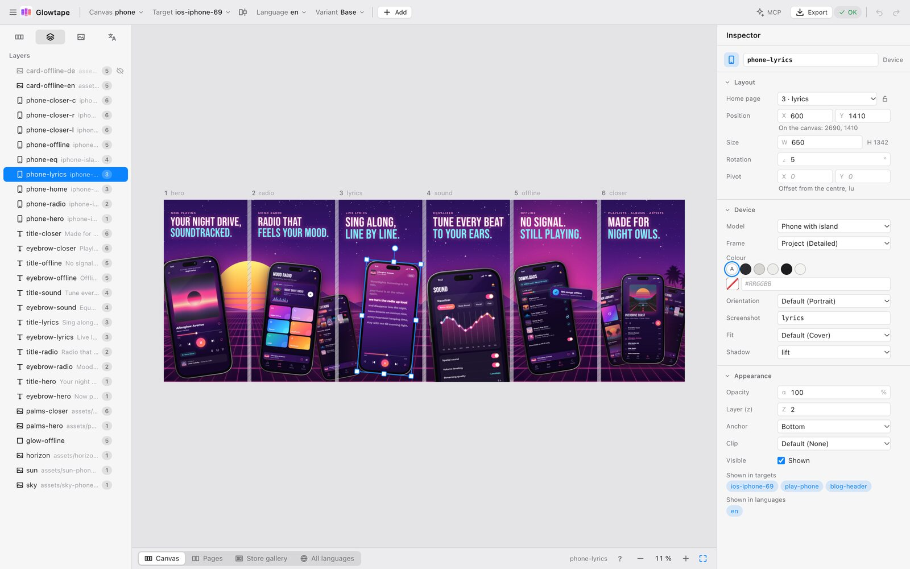
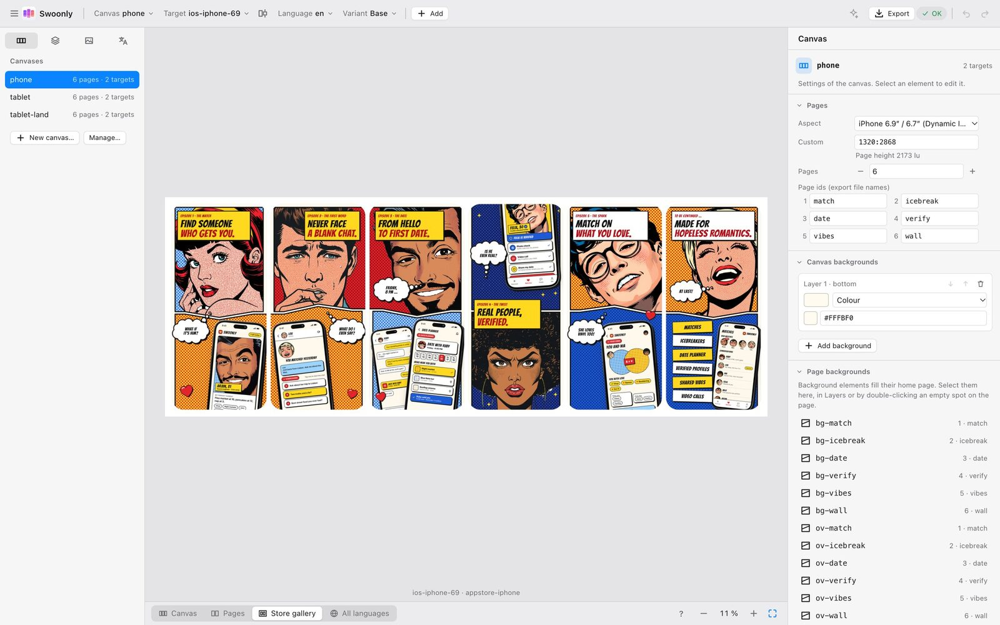
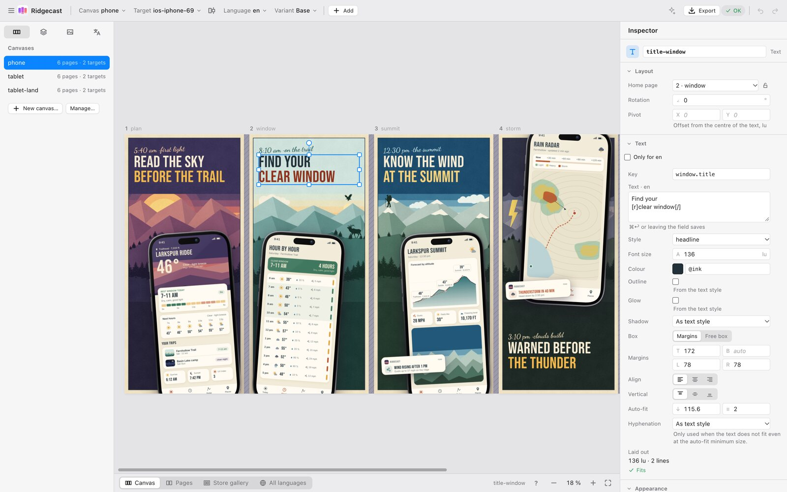
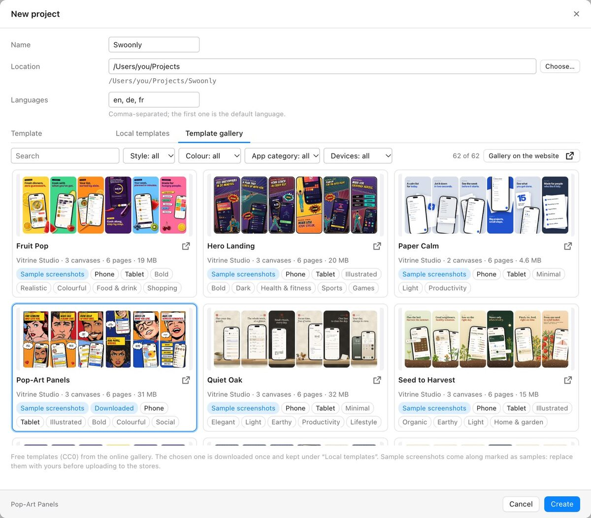
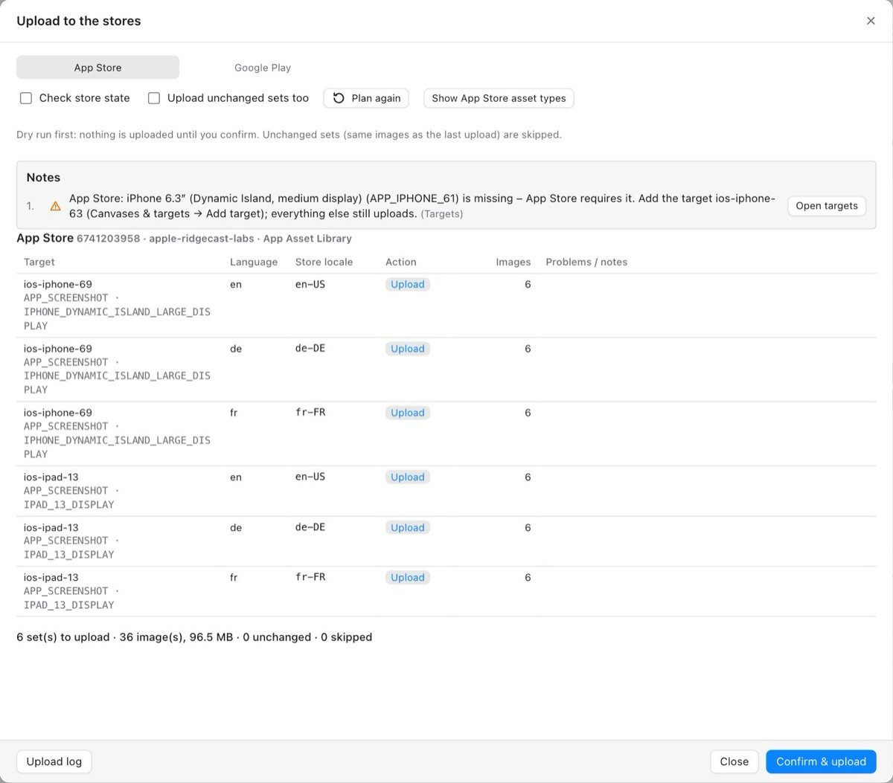
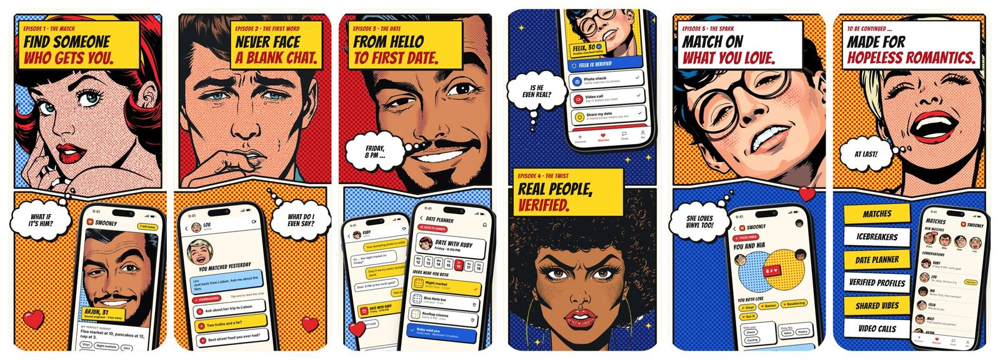
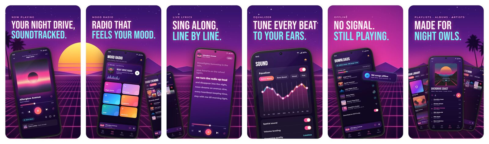
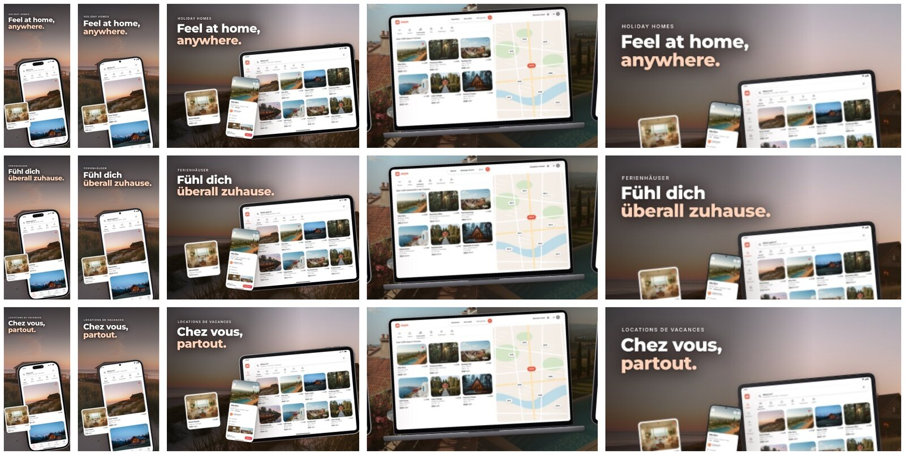

# Vitrine Studio

Vitrine Studio is an open-source desktop app for creating App Store and Play Store
screenshots: device frames, texts, translations and panorama sets, designed once
and rendered for every language, device class and store – with store upload and
an MCP interface so AI assistants such as Claude can design and translate
alongside you.

Instead of composing individual images, you design one continuous canvas. A
device that spans two screenshots exists exactly once, backgrounds run across
all pages, and gaps between pages match the store gallery so transitions line
up. The same layout adapts to other aspect ratios and to landscape sets built
from grouped portrait pages. Projects are plain folders of YAML files and
images: no account, no cloud, Git-friendly. The desktop app, the `vitrine`
command line tool and the MCP server work on the same core.

**Website:** [www.vitrinestudio.app](https://www.vitrinestudio.app) ·
**Download:** [latest release](https://github.com/vitrinestudio-app/vitrine/releases/latest) ·
**Documentation:** [user guide](https://www.vitrinestudio.app/docs/) ·
**Templates:** [template gallery](https://www.vitrinestudio.app/gallery/)

<picture>
  <source media="(prefers-color-scheme: dark)" srcset="docs/gui/editor-dark.jpg">
  
</picture>

## Status

**Version 1.0.0** – the first stable release. Downloads are on
[GitHub Releases](https://github.com/vitrinestudio-app/vitrine/releases/latest)
and the [download page](https://www.vitrinestudio.app/download/):

| Platform | Download | Signing |
|---|---|---|
| macOS 11+ (Apple silicon and Intel) | universal `.dmg` | signed with a Developer ID and notarised by Apple |
| Windows 10/11 (x64) | setup `.exe` (per user, no admin rights) | **not code-signed** – SmartScreen warns once about an "Unknown publisher": *More info* → *Run anyway* |
| Linux (x86_64) | AppImage, `.deb` and `.rpm` | unsigned packages; verify with `SHA256SUMS.txt` |
| Build servers / CI | command line archives (macOS, Windows, Linux x86_64 and aarch64, static musl builds) and the container image `ghcr.io/vitrinestudio-app/vitrine-cli` | checksums in `SHA256SUMS.txt` |

Installing, updating and verifying downloads:
[Install & update](https://www.vitrinestudio.app/docs/install/).

Store upload has been verified with a live App Store Connect account for
screenshots and the product page header and search results creatives. Other
Apple platforms (Mac, Apple Watch, iPhone Duo) and Google Play have been
tested against simulated stores so far – check the result in App Store
Connect or the Play Console after your first upload. The gallery gap widths
of the native store apps are still estimates (see
[Open questions](#open-questions)).

The architecture – concepts, project format, pipeline, front ends and the
decisions behind them – is in [`ARCHITECTURE.md`](ARCHITECTURE.md); the
current state and the release plan in
[`docs/plan/STATUS.md`](docs/plan/STATUS.md) and
[`docs/plan/phase-7.md`](docs/plan/phase-7.md).

## Features

**Canvas & layout**

- One continuous **canvas** per set instead of single images: backgrounds
  run across pages, a device spanning two screenshots exists once, and the
  gaps between pages match the store gallery, so **panoramas** line up.
- **One layout, many formats**: vertical anchors, two portrait pages
  grouped into one landscape image, variants with overrides per format –
  content is never maintained twice.
- **Groups** that scale as one (also per variant); images clipped to a
  rectangle or ellipse (`clip_to`).
- Every preview comes from the same Rust renderer as the export; every
  change is saved at once as plain YAML, with undo history.

**Devices & frames**

- iPhone (including the foldable iPhone Duo, open or folded), iPad, Mac,
  Android phones and tablets, Chromebook, Apple Watch and Wear OS
  (screenshot-only exports), browser windows and notebooks.
- **Parametric frames** in two styles, **Apple Product Bezels** you import
  yourself, or **your own frame packages** (PNG/SVG + `frame.yaml`). No
  vendor artwork is included.
- Imported bezels can be **stored in a private project**, so CI renders
  them too.

**Texts, styles & fonts**

- Texts with inline markup, auto-fit and highlighted **spans with boxes**
  (padding, corner radius); shared text styles.
- **Fonts**: Inter and nine more bundled OFL families, the project's own
  fonts and the fonts installed on your computer; used system fonts can be
  **stored in the project** so every machine renders the same. Bundled
  script fallbacks for Arabic, Hebrew, Devanagari, Bengali, Tamil and Thai.

**Languages**

- **Fallback chains** for texts and screenshots (e.g. `fr-CA` → `fr` →
  the default language), per-language overrides, opt-in automatic
  hyphenation.
- Translation exchange as **CSV, XLIFF 1.2 and XLIFF 2.0**.
- Screenshot import from fastlane snapshot/screengrab or plain folders.

**Design checks**

- `validate` and the validation panel report missing screenshots,
  overflowing texts and store rules per target × language, and the
  **required store sets** (App Store: iPhone 6.3″, iPad 13″ / Mac when
  targeted; Google Play: phone screenshots and the feature graphic).
- They also look at the rendered images: low contrast, text too close to a
  device, covered or cut screens, devices cut at the edge, seams and
  corners in the store gallery.

**Export**

- Store formats from presets: App Store and Google Play screenshot sets,
  App Store header and search results creatives, the Play feature graphic,
  web slides and banners cut from the same canvas.
- PNG/JPEG for every target × language, incremental, in Vitrine Studio's
  own folder layout or the **fastlane** `deliver`/`supply` layout, with an
  **`index.html`** overview.

**Store upload**

- **App Store Connect** through the App Asset Library: screenshots for
  every device, iPhone Duo and the header and search results creatives.
- **Google Play**: screenshots and the feature graphic.
- From the app, the CLI or an AI assistant – always **plan → confirm →
  execute**; unchanged sets are skipped; keys stay in the system keychain
  (or environment variables in CI).

**Templates & gallery**

- Start a project from a template, save your own canvases as a template,
  insert canvases from one.
- The online [template gallery](https://www.vitrinestudio.app/gallery/)
  (free CC0 templates) is a tab in the *New project* dialog; browsing and
  downloading need no account, publishing uses a GitHub login.

**AI assistants (MCP)**

- An MCP server hosted by the desktop app, with an **Add to Claude
  Desktop** button; Claude Code and any other MCP client connect through
  `vitrine mcp`.
- The assistant creates and edits projects, translates, looks at rendered
  previews, validates, exports and plans uploads; its edits appear live
  and are one undo step each.

**Command line & CI**

- The `vitrine` command line tool does everything without the app: new
  projects, render, export, validate, strings, screenshot import, frames,
  fonts, templates, gallery, upload and MCP.
- `validate --format github|gitlab|junit` for CI reports, store keys from
  environment variables, exit codes for scripts.

**Colour management & updates**

- Display P3 and other embedded colour profiles (PNG and JPEG) are
  converted to sRGB when images are read.
- **In-app updater**: a daily check (can be switched off) that only asks
  GitHub for a newer version; the macOS app, the Windows setup and the
  AppImage update themselves after a signature check, deb/rpm installs
  show a notice.

## Screenshots

The store gallery view shows a target as the store will, gaps included:

<picture>
  <source media="(prefers-color-scheme: dark)" srcset="docs/gui/gallery-view-dark.jpg">
  
</picture>

Editing a headline, with its settings in the inspector:

<picture>
  <source media="(prefers-color-scheme: dark)" srcset="docs/gui/text-editing-dark.jpg">
  
</picture>

*New project* with the online template gallery:

<picture>
  <source media="(prefers-color-scheme: dark)" srcset="docs/gui/new-project-dark.jpg">
  
</picture>

The store upload plan – what will be uploaded, replaced or skipped – before
anything is sent:

<picture>
  <source media="(prefers-color-scheme: dark)" srcset="docs/gui/upload-plan-dark.jpg">
  
</picture>

### Renders

Store gallery previews as Vitrine Studio renders them. An iPhone set made
from the *Pop-Art Panels* template – one canvas, a phone crossing pages 3
and 4:



A Google Play phone set from the *Synthwave Sunset* template:



One project, many formats and languages: the first image of each target of
a project made from the *Warm Stay* template – iPhone, Android phone, iPad
landscape, a Mac web banner and the Play feature graphic, in English,
German and French:



The repository also holds a complete example project,
[`tests/fixtures/example`](tests/fixtures/example): a fictional garden
planner with iPhone, Google Play, iPad, Mac, web and banner targets in four
languages (with deliberate fallbacks). It is the reference for the
golden-image tests.

## Integrations

| Integration | Where | State |
|---|---|---|
| CLI container image | `ghcr.io/vitrinestudio-app/vitrine-cli` | built with every release (amd64, arm64) |
| GitHub Action | [`vitrinestudio-app/vitrine-github-action`](https://github.com/vitrinestudio-app/vitrine-github-action) | repository online; release tag and Marketplace listing coming |
| GitLab CI/CD components | `gitlab.com/vitrinestudio/vitrine-gitlab-ci` | coming – draft in [`integrations/gitlab/`](integrations/gitlab/) |
| fastlane plugin | `fastlane-plugin-vitrine` (proposed repo `vitrinestudio-app/fastlane-plugin-vitrine`) | draft in [`integrations/fastlane-plugin/`](integrations/fastlane-plugin/), not on RubyGems yet |
| Agent skill | [`vitrinestudio-app/vitrine-agent-skill`](https://github.com/vitrinestudio-app/vitrine-agent-skill) | online: `npx skills add vitrinestudio-app/vitrine-agent-skill` |

The sources live in [`integrations/`](integrations/) (MIT). Setup:
[Automation](https://www.vitrinestudio.app/docs/automation/) (CI, container
image, uploading from CI) and
[AI assistants](https://www.vitrinestudio.app/docs/ai-mcp/) (MCP, agent
skill).

## Command line

```sh
vitrine new my-app --lang en --lang de        # new project (--template <name|id|file>)
# put screenshots into my-app/screenshots/en/ios-phone/<key>.png (see project.yaml)
vitrine validate --project my-app             # what is missing or does not fit
vitrine render --project my-app --gallery     # preview PNG of a store gallery
vitrine export --project my-app               # PNG/JPEG files in my-app/export/<target>/<lang>/
```

Try it on the example: `vitrine export --project tests/fixtures/example`.
Further commands: `strings` (CSV/XLIFF), `import screenshots`, `frames`,
`fonts`, `template`, `gallery`, `upload`, `mcp` and `install-cli` – see
`vitrine --help` and the
[CLI reference](https://www.vitrinestudio.app/docs/cli/). Exit codes: `0`
success, `1` the project has problems, `2` the command could not run.
For CI see [Automation](https://www.vitrinestudio.app/docs/automation/).

## AI assistants (MCP)

The desktop app hosts an [MCP](https://modelcontextprotocol.io) server: the
assistant works on the project you have open, every change appears live and
is one undo step labelled with the client's name. Nothing goes over the
network: the server listens only on your computer.

- **Claude Desktop**: App settings → *AI assistants (MCP)* → **Add to
  Claude Desktop…**, then restart Claude Desktop.
- **Claude Code**: `claude mcp add vitrine-studio -- /path/to/vitrine mcp`
  (the exact command is shown in the same settings section).
- **Any MCP client**: a stdio server running `vitrine mcp`; it connects to
  the running app or starts it. Without the app (CI, scripts):
  `vitrine mcp --headless --project /path/to/my-app`.
- **Agent skill** with a store-screenshot workflow for MCP-capable agents:
  `npx skills add vitrinestudio-app/vitrine-agent-skill`.

Setup, example prompts and tools:
[AI assistants](https://www.vitrinestudio.app/docs/ai-mcp/).

## Building from source

Requirements:

- [rustup](https://rustup.rs); the toolchain (Rust 1.99.1) is pinned in
  `rust-toolchain.toml` and installed automatically.
- For the GUI, the [Tauri 2 prerequisites](https://v2.tauri.app/start/prerequisites/)
  of your platform (on Linux e.g. `libwebkit2gtk-4.1-dev`, `libgtk-3-dev`,
  `libayatana-appindicator3-dev`, `librsvg2-dev`, `libxdo-dev`).
  No Node.js or npm is needed.

```sh
git clone https://github.com/vitrinestudio-app/vitrine.git && cd vitrine
cargo run -p vitrine-gui --release   # desktop app (start screen)
cargo run -p vitrine-gui -- tests/fixtures/example   # … opening a project
cargo install --path crates/cli      # the `vitrine` command line tool
cargo test --all                     # run tests
```

Self-compiled builds never look for updates. Contributor notes (commands,
conventions, architecture): [`AGENTS.md`](AGENTS.md),
[`ARCHITECTURE.md`](ARCHITECTURE.md) and [`CONTRIBUTING.md`](CONTRIBUTING.md).

## Workspace layout

| Path | Crate | Purpose |
|---|---|---|
| `crates/core` | `vitrine-core` | Project model, YAML IO, operations API, resolution, layout, validation, catalogs, templates |
| `crates/render` | `vitrine-render` | Rasterization, parametric device frames, text rendering, export, design checks |
| `crates/publish` | `vitrine-publish` | App Store Connect, Google Play and gallery clients, keychain |
| `crates/app` | `vitrine-app` | Shared application layer: session, commands, preview cache, settings (GUI and MCP) |
| `crates/mcp` | `vitrine-mcp` | MCP server (rmcp): tools and resources over the application layer |
| `crates/cli` | `vitrine-cli` | Command line interface, binary `vitrine` |
| `crates/gui` | `vitrine-gui` | Tauri 2 desktop app, frontend in plain HTML/CSS/JS |
| `crates/api-server` | `vitrine-api-server` | Backend of api.vitrinestudio.app (template gallery, GitHub login) |
| `integrations/` | | CI integrations and the agent skill (GitHub Action, GitLab CI, fastlane plugin, agent skill; MIT) |
| `website/` | | www.vitrinestudio.app (Hugo) with the user guide |
| `docs/` | | Plans, guide notes, API and release docs, README images; historical concept and ADRs in `docs/archive/` |

## License

Copyright © 2026 Looking4Cache UG (haftungsbeschränkt).

Vitrine Studio is free software: you can redistribute it and/or modify it
under the terms of the GNU General Public License as published by the Free
Software Foundation, either version 3 of the License, or (at your option)
any later version (`GPL-3.0-or-later`, see [`LICENSE`](LICENSE)). It is
distributed in the hope that it will be useful, but WITHOUT ANY WARRANTY;
without even the implied warranty of MERCHANTABILITY or FITNESS FOR A
PARTICULAR PURPOSE.

- **Contributions** need a signed contributor licence agreement
  ([`CLA.md`](CLA.md)): you keep your copyright and grant the project owner
  a licence that also allows distributing the code under other licences.
  See [`CONTRIBUTING.md`](CONTRIBUTING.md).
- **Integrations** in [`integrations/`](integrations/) (CI integrations and
  the agent skill) are MIT-licensed (a `LICENSE` in each folder): they only
  run the `vitrine` program or talk to its MCP server.
- **Name and logo** (`assets/brand/`, the app icons in `crates/gui/icons/`,
  `crates/gui/ui/img/logo.svg`) are not covered by the GPL: © Looking4Cache
  UG (haftungsbeschränkt), all rights reserved. Unmodified copies of Vitrine
  Studio may carry them; forks must use their own name and logo
  ([`assets/brand/README.md`](assets/brand/README.md)).
- **Bundled third-party data** keeps its own licence: the bundled fonts
  (Inter, Montserrat, Playfair Display, Lora, Nunito, Oswald, Bebas Neue,
  Caveat, Dancing Script, JetBrains Mono, and Noto script fallbacks) under
  the SIL Open Font License 1.1 (one `OFL.txt` per family in
  [`assets/fonts/`](assets/fonts/), sources and checksums in
  [`assets/fonts/SOURCES.md`](assets/fonts/SOURCES.md)), the hyphenation
  patterns under MIT/BSD/permissive notices
  ([`assets/hyphenation/LICENSES.md`](assets/hyphenation/LICENSES.md)).
  Rust dependencies are under permissive licences (MIT, Apache-2.0, BSD,
  ISC, Zlib, MPL-2.0, Unicode-3.0, …), all compatible with the GPL v3.
  Decision: [`ARCHITECTURE.md`](ARCHITECTURE.md) §13 (licences; former
  ADR 0022).
- **Gallery templates** are published under CC0 by their uploaders
  ([terms of use](https://www.vitrinestudio.app/terms/)).

## Open questions

- **Gallery gap widths** of the native store apps (iOS App Store on iPhone
  and iPad, Mac App Store, Play Store app) are estimates marked
  `not yet measured` in `crates/core/data/galleries.yaml`; only the store
  websites have been measured. They still have to be measured on real
  devices.
