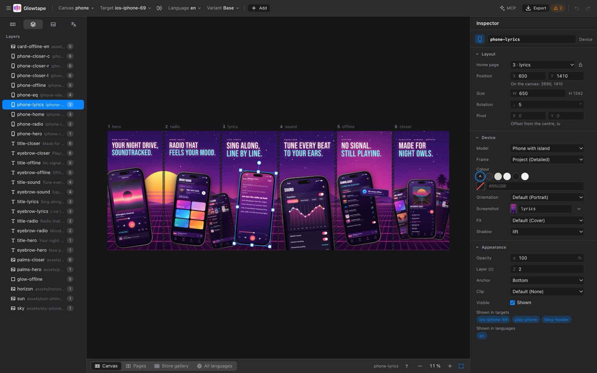
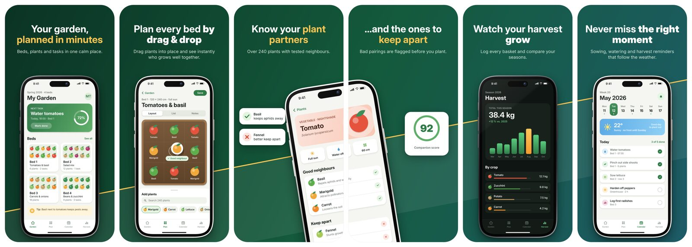
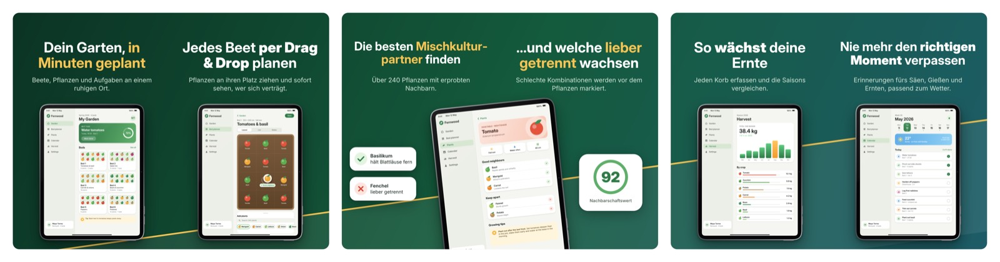
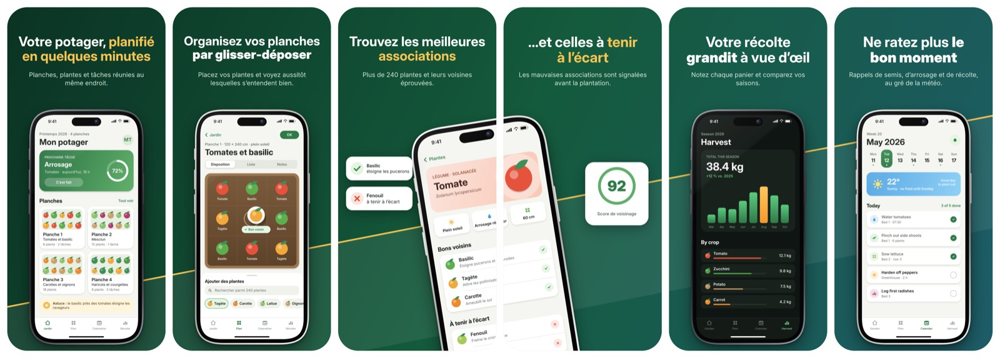
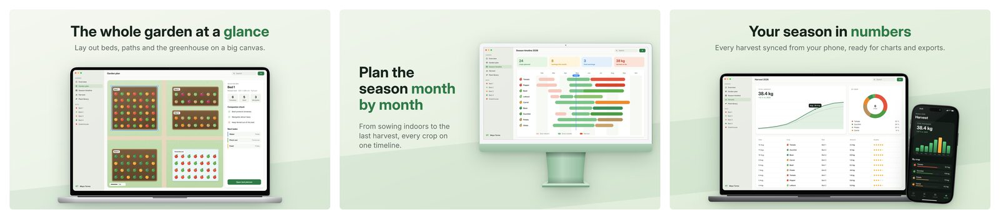
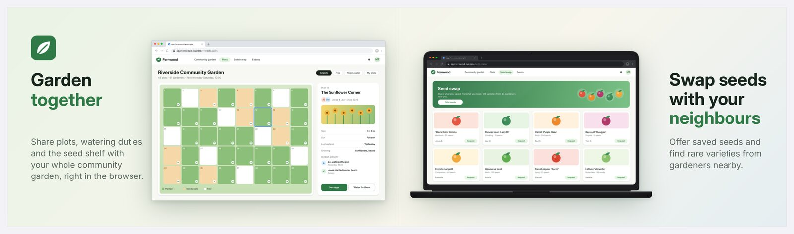
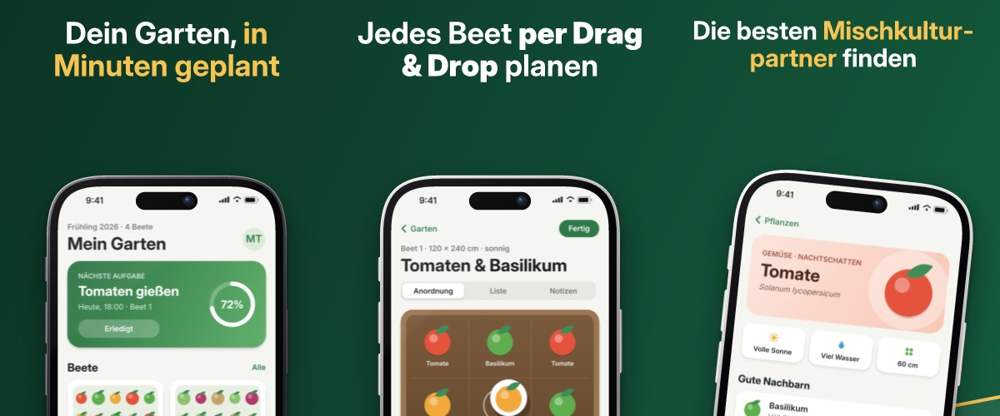

# Arrangia

Arrangia is an open-source desktop app for creating App Store and Play Store
screenshots: device frames, texts, translations and panorama sets, designed once
and rendered for every language, device class and store – with store upload and
an MCP interface so Claude can design and translate alongside you.

Instead of composing individual images, you design one continuous canvas. A
device that spans two screenshots exists exactly once, backgrounds run across
all pages, and gaps between pages match the store gallery so transitions line
up. The same layout adapts to other aspect ratios and to landscape sets built
from grouped portrait pages.

Website: <https://arrangia.app>

## Status

**Pre-alpha. Phase 1 (core + command line) and Phase 2 (desktop editor)
are complete; Phase 3 (languages & import) is nearly done** – per-language
text overrides, font fallbacks, opt-in automatic hyphenation, screenshot
import (fastlane and folder layouts), translation exchange via CSV and
XLIFF, and imported Apple Product Bezels (still to be verified with the
real package). Projects can be created, designed, translated, validated
and exported in the desktop app, or headless with the `arrangia` command
line tool; store upload and the MCP server are not built yet. The full
concept (in German) is in [`docs/KONZEPT.md`](docs/KONZEPT.md), the task
lists in [`docs/plan/`](docs/plan/) (`phase-1.md` … `phase-3.md`, with
known gaps under "Follow-ups"), the current state in
[`docs/plan/STATUS.md`](docs/plan/STATUS.md).

### Desktop editor

One canvas per strip with the store gaps hatched, direct manipulation
(move, resize, rotate, snapping), an inspector per element kind, layers,
assets with drag & drop import, a translations table and inline text
editing, targets from store presets, a validation panel and an export
dialog. Every preview is rendered by the same Rust pipeline as the
export; every change is saved immediately as plain YAML.




### Example

[`tests/fixtures/example`](tests/fixtures/example) is a complete project
for a fictional garden planner, exported from one YAML file into iPhone,
Google Play, iPad landscape, Mac App Store, web slides and banner targets
in English, German, French and Canadian French (which inherits all but
two texts from French). Store gallery previews as Arrangia renders them:



The same phone pages as an iPad landscape set (two pages per image,
tablet frames, a variant with adjusted positions), in German:



In French, with the French app screenshots for the first three pages and
the English ones as fallback for the rest; the German set above shows a
language override that lets "Mischkultur-partner" be hyphenated
automatically instead of shrinking the headline:



Mac App Store set and a web app in a browser window and in a notebook
with browser chrome:





A blog header cut from the same canvas without gaps:



The app screenshots inside the frames are generated
(`crates/render/examples/screens.rs`); device frames are drawn
parametrically, no vendor artwork is included.

## Building

Requirements:

- [rustup](https://rustup.rs); the toolchain (Rust 1.99.1) is pinned in
  `rust-toolchain.toml` and installed automatically.
- For the GUI, the [Tauri 2 prerequisites](https://v2.tauri.app/start/prerequisites/)
  of your platform (on Linux e.g. `libwebkit2gtk-4.1-dev`, `libgtk-3-dev`,
  `libayatana-appindicator3-dev`, `librsvg2-dev`, `libxdo-dev`).
  No Node.js or npm is needed.

```sh
cargo build                          # build everything
cargo test --all                     # run tests
cargo run -p arrangia-cli -- --help  # command line interface (binary: arrangia)
cargo run -p arrangia-gui            # desktop app (start screen)
cargo run -p arrangia-gui -- tests/fixtures/example   # … opening a project
```

## Command line

Quick start:

```sh
cargo install --path crates/cli                # or: cargo run -p arrangia-cli --release -- …
arrangia new my-app --lang en --lang de        # a phone project from a template
# put screenshots into my-app/screenshots/en/ios-phone/<key>.png (see project.yaml)
arrangia validate --project my-app             # what is missing or does not fit
arrangia export --project my-app               # PNG/JPEG files in my-app/export/<target>/<lang>/
```

Try it on the example: `arrangia export --project tests/fixtures/example`.

The `arrangia` binary works on a project folder (`--project <DIR>`, default:
the current folder):

```sh
arrangia new my-app --lang en --lang de      # project from a template (--template phone|minimal)
arrangia validate --project my-app           # findings by target/language; --format json, --preview, --strict
arrangia render --project my-app --canvas    # preview PNG: --page N | --image N | --canvas | --gallery
arrangia render --project my-app --target play-phone --page 2 --width 400 -o page.png
arrangia export --project my-app             # all targets × languages into my-app/export/
arrangia export --target ios-iphone-69 --lang de --force   # --force ignores the incremental cache

# translations for translators (CSV or XLIFF 1.2/2.0; markup becomes protected inline tags)
arrangia strings export --format xliff20 --lang fr -o translations/   # --format csv --context --missing-only
arrangia strings import translations/fr.xlf --dry-run                 # report: changed/new/unknown keys, overflows

# screenshots from fastlane snapshot, an Arrangia folder tree or a flat folder
arrangia import screenshots fastlane/screenshots --dry-run            # --device-map "iPhone 17 Pro Max=ios-phone" --save-mapping

# Apple Product Bezels (downloaded by you; stored app-wide, never in the project)
arrangia frames import /Volumes/Bezel-iPhone-18 --dry-run             # folder, zip or DMG
arrangia frames list
arrangia frames remove --model iphone-island                          # --color, --orientation; --all removes everything
```

Exit codes: `0` success (warnings fail only with `validate --strict`), `1`
the project has problems (validation errors, export failures), `2` the
command could not run (usage error, project not loadable, IO error).
`render` prints the path of the written PNG (default
`<project>/.cache/render/`). Colours are used on a terminal unless
`NO_COLOR` is set.

## Workspace layout

| Path | Crate | Purpose |
|---|---|---|
| `crates/core` | `arrangia-core` | Project model, YAML IO, operations API, resolution, layout, validation, catalogs |
| `crates/render` | `arrangia-render` | Rasterization, parametric device frames, text rendering, export |
| `crates/publish` | `arrangia-publish` | App Store Connect and Google Play upload, keychain |
| `crates/mcp` | `arrangia-mcp` | MCP server |
| `crates/cli` | `arrangia-cli` | Command line interface, binary `arrangia` |
| `crates/gui` | `arrangia-gui` | Tauri 2 desktop app, frontend in plain HTML/CSS/JS |
| `docs/` | | Concept and architecture decision records (`docs/adr/`) |

## Open questions

- **License: not yet decided.** Options are MIT OR Apache-2.0 or a copyleft
  license (MPL-2.0/GPL). Until this is settled there is no LICENSE file, no
  `license` field in the manifests, and all crates are `publish = false`.
  The bundled fonts (Inter) are under the SIL Open Font License
  (`assets/fonts/OFL.txt`).
- **Gallery gap widths** of the native store apps (iOS App Store on iPhone
  and iPad, Mac App Store, Play Store app) are estimates marked
  `not yet measured` in `crates/core/data/galleries.yaml`; only the store
  websites have been measured. They still have to be measured on real
  devices.
